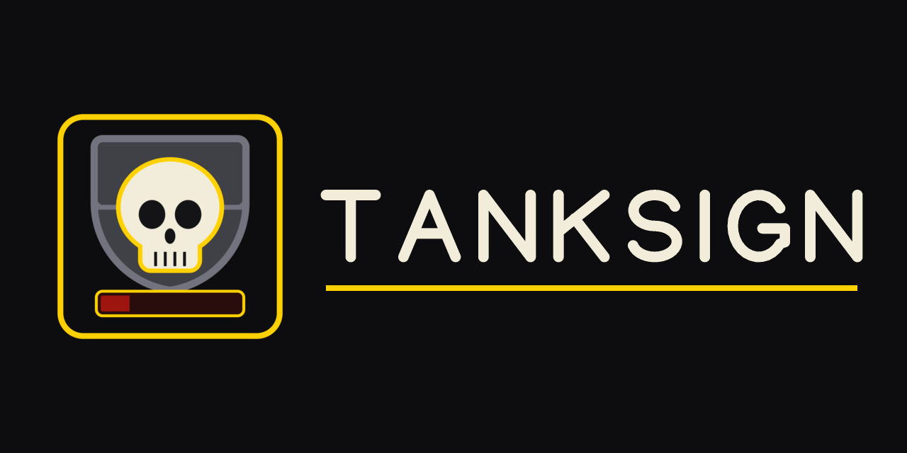
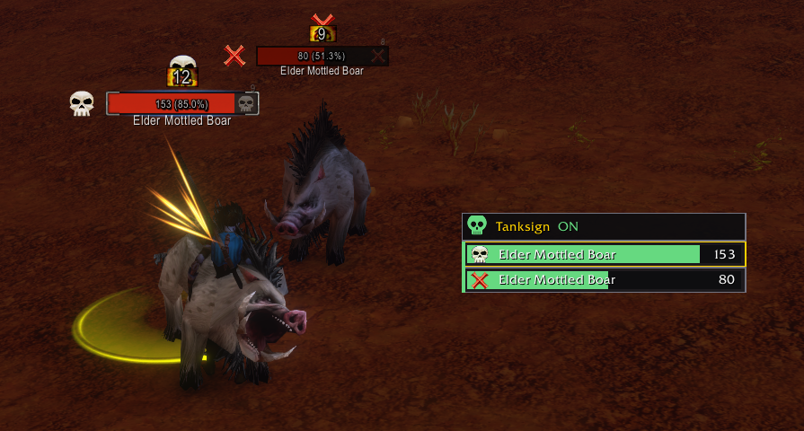
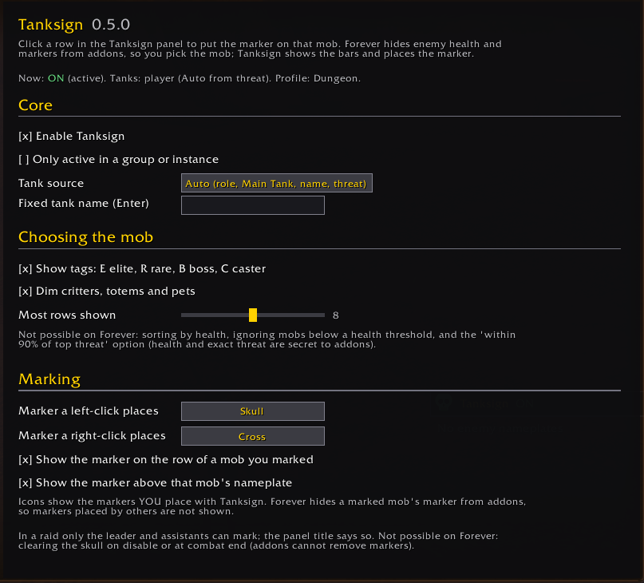
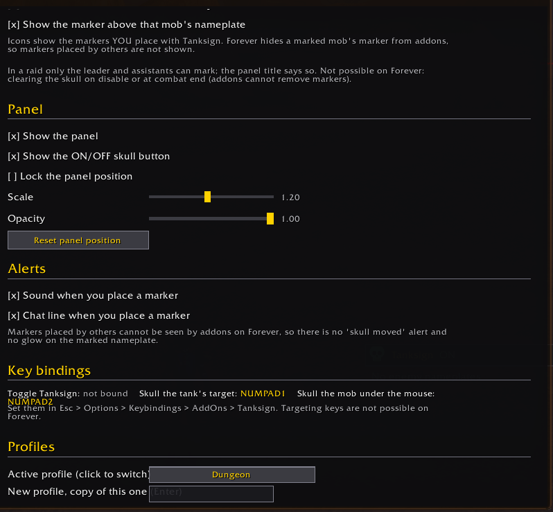

# Tanksign

**A click-to-skull panel for the mobs your tank is holding.** Tanksign lists the enemy mobs around
you, each with a live health bar, shows which ones the tank holds, and puts the skull on a mob with
one click. It is an addon for World of Warcraft, built for **WoW Forever**.

> **Status: 0.9.0 beta.** Everything below is confirmed in game on WoW Forever (open world and
> dungeons, in combat). See [docs/ROADMAP.md](docs/ROADMAP.md).

## Screenshots

Skull and X placed from the panel, in combat. The icons show on the rows and above the nameplates:

The options page (Esc > Options > AddOns > Tanksign):

 

## Why it is a panel and not automatic

Tanksign was planned to find the lowest-health mob the tank holds and skull it by itself. The
Forever client does not allow that, and Tanksign does not try to get around it:

- Enemy **health is secret** to addons (in and out of combat). An addon can show it in a health bar
  but cannot read or compare it, so it cannot pick the lowest mob. You spot it on the bars.
- Addons **cannot place raid markers** or **change your target** themselves. A click or key press
  you make can: Tanksign's rows and keys are secure buttons that run Blizzard's own marking code.

## Using it

- **Left-click** a row: put the **skull** on that mob. **Right-click**: put the **cross** (red X).
  Both work in combat, and both markers can be changed in the options.
- The skull or X you placed shows on that mob's row and above its nameplate. Forever hides a marked
  mob's marker from addons, so Tanksign shows only the markers **you** placed with it (rows, and the
  mouseover key when it can tell the nameplate). Markers placed by other players are not shown.
  When another player changes markers and Tanksign cannot tell which mob was hit (they put a
  marker on your skull or X mob, or removed one of yours), it clears **both** your skull and X
  icons rather than show a wrong one. The markers in the game stay as they are; click again to
  get the icons back. Someone marking a mob that has no marker yet leaves your icons alone.
- Bar colors: **green**, a tank holds it; **red**, in combat and no tank holds it (loose);
  **grey**, not pulled yet, or the client keeps the threat secret.
- Tags before the name: **E** elite, **R** rare, **B** boss, **C** caster (uses mana).
- Pets and totems are dimmed. Critters normally get no nameplate at all, so they never appear.
  Inside instances the client hides the creature type, so there only pets are dimmed.
- Your current target's row has a gold border.
- The skull button in the panel's title bar turns Tanksign on and off (green on, red off).
  Drag the title bar to move the panel (out of combat, when unlocked).

All settings are on the options page: Esc > Options > AddOns > Tanksign, or `/ts options`. Settings
live in profiles (for example "Dungeon" and "Raid"), and Tanksign can switch to them by itself when
you enter a dungeon or raid. Optional sound or chat line when you place a marker.

Key bindings (Esc > Options > Keybindings > AddOns > Tanksign): **Toggle Tanksign**, **Skull the
tank's target**, **Skull the mob under the mouse**. Blizzard's own "Set skull on target" key also
still works.

## Commands

| Command | What it does |
|---|---|
| `/ts` or `/tanksign` | list commands |
| `/ts on`, `/ts off`, `/ts toggle` | turn Tanksign on or off |
| `/ts status` | state, tanks, marker |
| `/ts show`, `/ts hide`, `/ts lock`, `/ts unlock` | panel visibility and dragging |
| `/ts tank <Name>` | fixed tank name (`/ts tank` alone clears it) |
| `/ts source auto\|role\|maintank\|name\|threat` | where the tank comes from (auto = in that order) |
| `/ts marker <1-8 or name>` | the marker a left-click places (default skull) |
| `/ts rightmarker <1-8 or name>` | the marker a right-click places (default cross) |
| `/ts icons` | marker icons on rows and nameplates (toggle) |
| `/ts rows <1-15>`, `/ts scale <0.5-2>` | panel size |
| `/ts group` | only active in a group or instance |
| `/ts tags`, `/ts dim` | row tags, and dimming of critters, totems and pets (toggles) |
| `/ts reset`, `/ts reset position` | defaults, or only the panel position |
| `/ts options` | open the options page |
| `/ts profile [name \| list]` | switch to a profile, or create it as a copy of the current one |
| `/ts debug` | explain each row in chat |
| `/ts diag` | what the client did with the panel rows (for bug reports) |
| `/ts probe` | API report for troubleshooting (`/ts probe help`) |

## Known limits

- **Rows come from nameplates.** A mob without a visible enemy nameplate has no row. Keep enemy
  nameplates on (Esc > Options > Nameplates) and in range.
- **Rows are not sorted by health**, because health is secret. They follow nameplate order. For the
  same reason there is no "ignore mobs below X% health" option, and no "within 90% of top threat"
  option (exact threat values are secret on nameplates).
- **Combat lockdown.** In combat the panel cannot be moved, hidden or rebuilt. Turning Tanksign off
  in combat fades the panel and stops its updates at once; it hides when the fight ends. Changing
  the marker or the tank applies after the fight.
- **Marking permission.** In a raid only the leader and assistants can place markers (Blizzard's
  rule). The panel title shows "can't mark" when you cannot, and a one-time chat message explains.
- Tanksign cannot see which mob carries the skull (that is secret too), so it cannot warn about a
  marker someone else moved, glow the marked nameplate, or clear the skull for you.
- **No targeting from the panel.** Forever ignores every secure way of targeting a mob through its
  nameplate (tested: `type=target`, `/target nameplate1`, `/target [@nameplate1]`), and no macro
  option targets by raid marker. Click the mob or its nameplate as usual.
- A row also appears for a friendly nameplate if friendly nameplates are turned on: Forever does
  not let secure code tell friend from foe on nameplates.

## Install

Download the zip from the releases page and extract it into
`World of Warcraft\_forever_\Interface\AddOns\`, so the result is `...\AddOns\Tanksign\`.

## Credits and support

Made by **Decoupled Lane Studio**. Support: support@decoupledlane.com. Bugs and ideas:
[GitHub issues](https://github.com/TankerALane/tanksign/issues).

Released under the [MIT License](LICENSE). World of Warcraft is a trademark of Blizzard
Entertainment; this project is not affiliated with Blizzard.
